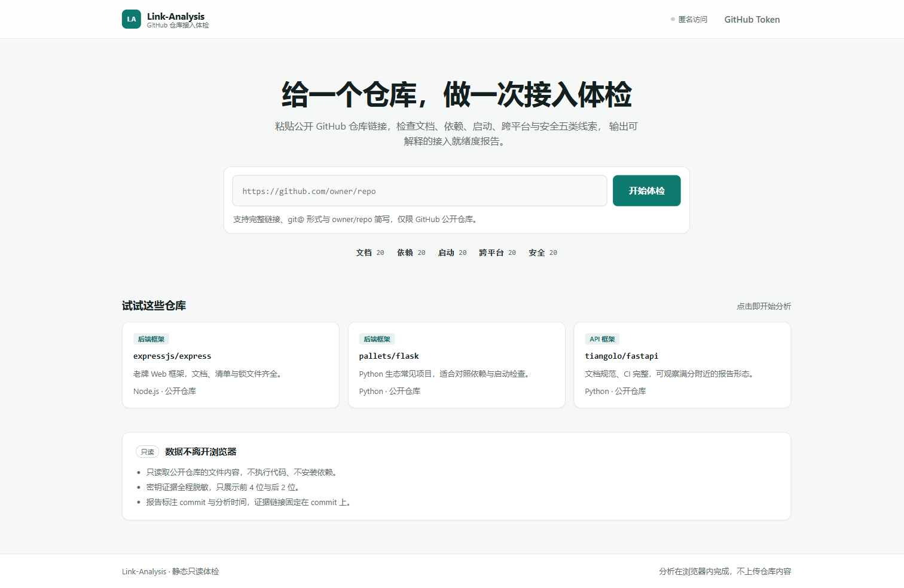
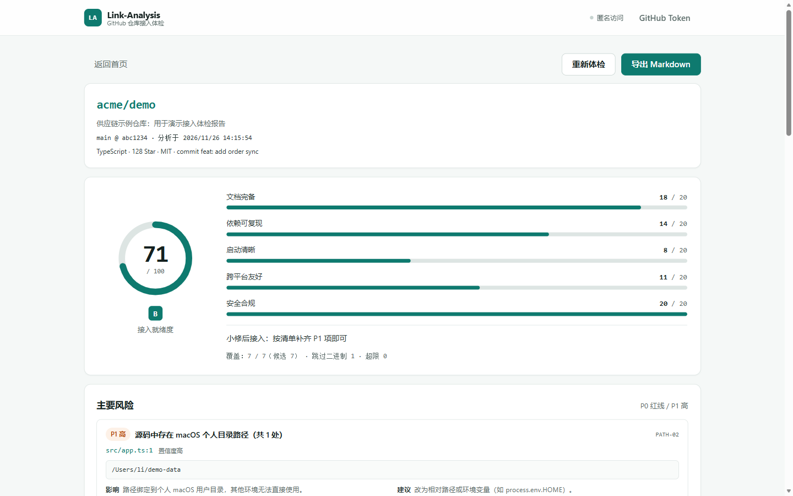

# Link-Analysis · Git 仓库接入体检

输入一个公开 GitHub 仓库链接，在浏览器内完成静态体检，输出「新人能否顺利接手、坑在哪」的可解释报告。

- 五个维度：文档、依赖、启动、跨平台、安全，各 20 分
- 每条失分可回溯到规则 ID、文件:行与 commit 固定链接
- 密钥证据全程脱敏；不执行代码、不安装依赖、不上传仓库内容
- 可导出 Markdown 整改清单

> 界面预览（本地演示数据，不是真实仓库结果）：  
>   
> 

## 在线演示

- 正式地址：待发布。GitHub Pages 工作流已就绪（`.github/workflows/deploy.yml`），需要先确认 GitHub 账号与仓库地址（待确认项 P-01）。
- 本地运行：见下方「快速开始」。

## 快速开始

环境：Node.js 20+（开发验证使用 Node 24）、npm。

```bash
npm install      # 安装依赖
npm run dev      # 本地开发 http://localhost:5173
npm test         # Vitest 单元测试
npm run build    # 类型检查 + 生产构建（dist/）
npm run verify:repos   # 可选：真实仓库验证，会消耗 GitHub API 额度
```

### 使用方式

在首页粘贴任意一种形式：

```text
https://github.com/expressjs/express
https://github.com/expressjs/express.git
git@github.com:expressjs/express.git
expressjs/express
```

也支持 `?repo=owner/name` 直接打开报告（分享链接）。

匿名访问每小时 60 次 GitHub API 请求；可在右上角配置只读 Token 提升到 5000 次。Token 只保存在本机 `localStorage`，仅发送到 `api.github.com`。

## 评分口径

| 维度 | 满分 | 规则 |
| --- | --- | --- |
| 文档完备 | 20 | DOC-01 README（8）· DOC-02 安装/构建（6）· DOC-03 配置（4）· DOC-04 结构（2） |
| 依赖可复现 | 20 | DEP-01 清单（10）· DEP-02 锁文件/固定版本（6）· DEP-03 可解析（4） |
| 启动清晰 | 20 | RUN-01 启动线索（8）· RUN-02 README 启动命令（6）· RUN-03 版本声明（3）· RUN-04 跨平台（3） |
| 跨平台友好 | 20 | PATH-01 盘符（8）· PATH-02 `/Users/`（5）· PATH-03 `/home/`（4）· PATH-04 `file://`/UNC（3） |
| 安全合规 | 20 | SEC-01 私钥（8）· SEC-02 `.env` 入库（6）· SEC-03 高置信 Key（4）· SEC-04 其他敏感（2） |

- 分项通过得满分，失败或不适用得 0；总分为五维之和。
- **P0 红线**：源码/配置中的私钥、真实值 `.env`、高置信 Key 任一命中 → 总分封顶 39。
- 等级：≥85 A、70–84 B、50–69 C、<50 D；评价文案见报告页。
- 覆盖率只披露、不调分；文件树截断或读取失败时显示「数据不完整」。

完整规则与正则口径见 [`docs/02-rules-and-scoring.md`](docs/02-rules-and-scoring.md)。

## 更新跟踪设计（四问）

> 题目要求设计说明即可。本节同时标注「设计」与「v1 已实现」，不把设计能力表述为已上线。

### 1. 怎么发现更新

每份报告记录 `owner/repo + branch + commit SHA + 分析时间`。用户点击「重新体检」时重新读取默认分支与 HEAD SHA，新报告头展示新的 `branch @ shortSha` 与分析时间。若未来加入报告缓存，可先比较 SHA：相同则复用旧报告并提示「commit 未变化」，不同则重新分析并展示新旧 SHA。

### 2. 怎么避免全量重算

Git 是内容寻址的，文件树里每个文件都有 blob SHA：

1. 首次体检按 `blobSha + ruleVersion` 缓存每个文件的 findings（IndexedDB）。
2. 复检时重新拉取文件树（1 次 API），比对 `path → blobSha`：未变直接复用缓存、只下载新增/变更文件、删除的文件丢弃 findings。
3. 文件级事实（README / 清单 / 锁文件 / 版本文件是否存在）由新树重新判定，成本极低。
4. 用「缓存 findings + 新增 findings」重新聚合评分（纯函数，毫秒级）。
5. `ruleVersion` 变化时整批失效，保证规则升级后结果一致。

### 3. 报告如何标注所基于的 commit

- 报告头固定展示 `owner/repo @ branch @ shortSha · 分析时间 · rules-v1 · 覆盖率`。
- 所有证据链接固定到 commit：`https://github.com/{o}/{r}/blob/{sha}/{path}#L{line}`，分支后续变动不影响证据。
- Markdown 导出包含相同字段；空仓库、限流、截断等异常不会生成伪造时间。

### 4. 失败或限流时怎么兜底

| 情况 | 处理 |
| --- | --- |
| 403 匿名额度耗尽 | 显示重置时间与 Token 入口；有缓存时会展示旧报告并标「可能过期」（缓存为 P1，未实现） |
| 429 二级限流 | 提示稍后重试，展示 `retry-after` 对应时间 |
| Token 失效（401） | 自动回退匿名请求一次，报告「已知限制」中提示；不自动清除 Token |
| 文件树截断 | 报告标「数据不完整」+ 覆盖率，不补分 |
| 部分文件失败 | 记录失败文件数，报告基于已分析文件，不中断 |
| raw 读取失败 | 回退 contents API 一次；仍失败则跳过并计数 |
| 网络失败 | 退避 500ms 重试一次；仍失败给出原因与重试入口 |
| 用户取消 | AbortController 终止在途请求，回到首页并保留输入 |

### 当前实现边界

| 能力 | 状态 |
| --- | --- |
| 报告头 / 导出 / 证据链接标注 commit | ✅ v1 已实现 |
| `?repo=owner/name` 分享链接 | ✅ v1 已实现 |
| 「重新体检」按钮 | ✅ v1 已实现（重新拉取，不做新旧 SHA 对比提示） |
| 401 Token 回退匿名一次 | ✅ v1 已实现 |
| 报告缓存 / 最近体检 | ⬜ 设计完成，未实现 |
| HEAD SHA 对比提示「commit 未变化」 | ⬜ 设计完成，未实现 |
| blob SHA 增量重扫 | ⬜ 设计完成，未实现 |
| ETag / 条件请求 | ⬜ 设计完成，未实现 |
| 新旧报告差异视图 | ⬜ 设计完成，未实现 |

## 真实仓库验证（2026-11-26）

命令：`npm run verify:repos`（Node 侧调用同一套 `analyzeRepo` 流水线）。完整报告保存在 [`docs/verification/`](docs/verification/)。

| 仓库 | commit | 覆盖 | 得分 | 用时 | 结果摘要 |
| --- | --- | --- | --- | --- | --- |
| `expressjs/express` | `43fca52` | 211 / 211（候选 211） | **73 / B** | 13.3s | 无 start/dev 启动线索（P1）；无锁文件、README 无启动命令等 P2 |
| `pallets/flask` | `49943b5` | 224 / 224（候选 224） | **76 / B** | 14.2s | 无启动线索（P1）；README 缺安装说明；测试目录 `.env` 仅提示 |
| `cmderdev/cmder` | `5655c5e` | 40 / 40（候选 40） | **85 / A** | 12.9s | 38 条 Windows 脚本/路径信息项；README 启动命令、版本声明为 P2/P3 |

人工抽查证据（5 条）：

1. Express `package.json` 只有 `test` / `lint` 等脚本，没有 `start` / `dev` → RUN-01 失败成立；已用 raw 文件核对。
2. Express 报告中的证据链接指向 `.../blob/43fca52.../package.json`，不随 master 变动。
3. Flask `tests/test_apps/.env` 变量为 `FOO/SPAM/EGGS/HAM`，且位于测试目录 → 按规则降级为信息项，不再扣 SEC-02。
4. Flask `src/flask/ctx.py` 的 `_cv_token: contextvars.Token` 是类型注解，不是密钥 → 通用赋值规则已收紧，不再误报。
5. cmder 的 `Cmder.bat` 等 Windows 脚本按 WIN-01 展示，全部为信息项，不影响总分。

验证过程中发现并修复的误报：test 目录 `.env` 计分、类型注解被当成凭证、无启动线索时 RUN-04 文案错误（详见 [`AI_USAGE.md`](AI_USAGE.md)）。

## 测试与质量

- 单元测试 135 例：URL 解析 13、分类/筛选 21、五类规则 55、评分 13、导出 7、GitHub client 13、报告/流水线 8 等；覆盖全部规则 ID 正反例与评分边界（100 / 76 / 红线 39）。
- 对照验收：1440 / 768 / 390 三档无横向滚动；控制台无报错；导出文件已验证包含 repo / branch / sha / 时间 / 覆盖率 / 脱敏证据。
- 构建产物：JS 46.3KB gzip + CSS 3.7KB gzip（远低于 250KB 目标）。
- 浏览器侧真实仓库验证受共享 IP 匿名额度限制时，使用同一流水线的 Node 验证脚本；UI 用本地 mock 路由验证全部状态。该边界已在 `AI_USAGE.md` 记录。

## 自检

用本工具分析 Link-Analysis 自身：待 GitHub 仓库创建并公开后执行（P-01），结果将补入本节。

## 隐私与安全

- 无后端、无数据库、无统计脚本；数据只在浏览器与 GitHub 之间流动。
- Token 仅存 `localStorage`、仅发往 `api.github.com`；不写入 URL、日志、报告或导出文件。
- 密钥证据在进入报告数据模型前脱敏；DOM 与导出中不存在完整值，也不提供复制入口。
- 测试中的密钥字面量运行时拼接；仓库不含真实密钥。

## 技术栈与目录

Vue 3 + TypeScript + Vite；样式手写 CSS 变量；图表为手写 SVG/CSS；测试 Vitest；开发期用 Playwright 做页面核对。

```text
src/core/
  github/    URL 解析、API/raw 请求、限流与错误映射
  select/    文件分类、排除规则、优先级与 400 上限
  rules/     文档 / 依赖 / 启动 / 跨平台 / 安全 / Windows 脚本
  score/     分项定义、聚合、P0 封顶、等级
  report/    报告模型、脱敏、Markdown 导出
  analyze.ts 完整流水线（可注入 fetch / AbortSignal / 进度回调）
src/ui/      首页、进度、报告页与组件
tests/       单元测试与内存 fixture
scripts/     真实仓库验证脚本
docs/        设计文档、进度跟踪、验证记录、截图
```

## 已知限制

- 仅分析公开 GitHub 仓库、默认分支、当前快照；不查 Git 历史。
- 静态扫描不执行代码、不安装依赖，不能判断项目「实际能否运行」。
- 密钥检测基于模式与启发式，存在误报/漏报；不是专业安全审计工具。
- 覆盖率上限 400 文件 / 单文件 512KB；超大仓库结论可能偏差。
- Monorepo 只扫描根目录与一层子目录的依赖清单。
- 私有仓库、子模块内容、LFS 指针、GitLab/Gitee 不在本期范围。

## 未实现（明确标注）

- AI 评分 / 接入建议：接口占位，UI 无入口，评分完全由规则引擎决定。
- 报告缓存、最近体检、增量重扫、差异视图、ETag：设计见技术文档 §9，v1 未实现。
- GitHub Pages 线上地址：工作流已就绪，等待仓库确认后发布（P-01）。

## 设计文档

- [需求与范围](docs/01-requirements.md)
- [检查规则与评分](docs/02-rules-and-scoring.md)
- [技术设计](docs/03-technical-design.md)
- [开发计划与验收](docs/04-development-plan.md)
- [开发进度跟踪](docs/05-progress.md)

## License

MIT，见 [LICENSE](LICENSE)。
